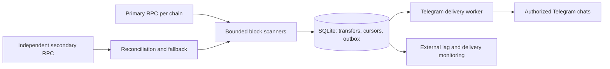

# USDT notification bot: architecture decision

Research date: 2026-10-26.

## Decision

Use a small Laravel 13 application on PHP 8.5 with two resumable block-range scanners, a SQLite transfer ledger, and a transactional Telegram outbox. Monitor only official USDT `Transfer` events on Ethereum mainnet and TRON mainnet. Default to incoming and outgoing transfers and notify only after chain finality.

Use two independent RPC vendors per chain. Suggested provider arrangement:

| Chain | Primary | Independent secondary | Finality source |
| --- | --- | --- | --- |
| Ethereum | Paid Alchemy Ethereum RPC | Paid QuickNode Ethereum RPC | `eth_getBlockByNumber("finalized", false)` |
| TRON | TronGrid JSON-RPC and native HTTP APIs | Paid QuickNode TRON RPC and native HTTP APIs | Native `/walletsolidity/getnowblock` |

These are provider candidates, not purchased or certified production accounts. Verify method support, historical retention, topic filters, rate limits, response-size limits, and finality behavior on the actual plans before launch. Different brand names do not by themselves prove independent infrastructure; check upstream dependencies and outage history.

Both chains support filtered `eth_getLogs` queries. TRON native solidity APIs provide an additional receipt-level verification and recovery path. Do not rely on hosted TRON gateways accepting Ethereum finality tags: current java-tron documentation and a TronGrid probe support `finalized`, while QuickNode's current TRON documentation describes narrower support. Obtain the TRON solidified height through the native API and pass explicit numeric heights to log queries.

Keep webhooks optional. QuickNode Streams is a documented cross-chain acceleration option if early delivery becomes necessary. Historical RPC replay remains the independent recovery mechanism.

## Scope and assumptions

- Approximately 100 distinct watched chain/address pairs in total across multiple users; also suitable for 100 on each chain, subject to actual activity and provider limits. Multiple users may independently subscribe to the same address.
- Support incoming, outgoing, and transfers between watched wallets. A transfer between two watched wallets creates one event; recipient routing determines whether to send one combined notification or distinct notifications to different subscribers.
- A self-transfer must not produce two messages to the same subscriber.
- No custody, withdrawals, transaction signing, swaps, general-purpose blockchain index, or monitoring of native ETH/TRX.
- Users receive notifications only after activating an individual access key. Wallet administration happens through operator-only commands scoped to a specific user initially; interactive wallet-management commands can follow.
- Private chats are the default. Users activate a key by starting the bot in a private chat. Optional group/channel delivery requires separate explicit authorization, appropriate bot permissions, and a policy for shared labels; possession of a group ID is not authorization.
- Adding a wallet starts at an explicitly recorded block by default; historical import is an explicit operation and does not silently send old activity.

## Multiple users and key-based access

Use Telegram's immutable numeric user ID as the external identity, not a mutable username. A user owns subscriptions, private wallet labels, amount/direction filters, and notification settings. A global address record can be shared for efficient scanning; it does not confer access to another user's labels, history, settings, or subscriptions.

The initial access mechanism is an individual, single-use activation key:

1. An operator issues a cryptographically random key with at least 256 bits of entropy through an operator-only Artisan command. Show the raw key once for secure distribution; store only its hash and metadata. Do not include keys in logs, fixtures, analytics, or committed files.
2. The user submits the key using `/start <key>` in a private bot chat, directly or through a Telegram start link. A compact base64url token fits Telegram's start-parameter limit. Do not log message bodies or credential-bearing links.
3. Validate key expiry and revocation, then consume it and bind an access grant to the Telegram user ID atomically. Default activation-key lifetime is 24 hours, configurable; the resulting grant has an independently configurable expiry and may instead remain valid until revoked.
4. Concurrent redemption by different users must yield exactly one successful binding. Redelivery of the same Telegram update is idempotent; it must not issue another grant. An already consumed key is not a reusable shared password.
5. Operators can revoke an unused key or an activated grant. Check grant validity during wallet administration, subscription changes, outbox creation, and immediately before sending. Revocation removes that grant's pending-delivery authorizations; cancel a delivery only if no other valid authorizer remains. Revocation cannot retract a Telegram request already in flight.

Unknown users can see only a neutral activation prompt. Rate-limit invalid attempts without exposing whether a key belongs to another user. Operator privileges are configured separately from ordinary access grants; a user key never grants global administration. Keep operator actions auditable without recording raw secrets.

Enforce user ownership in application services and queries, including CLI operations, exports, historical results, and recipient routing. Test isolation using two users following different wallets and two users following the same wallet. A user's activation or backfill must not expose another user's records or change their notification policy. Private labels must not leak into shared destinations.

Use one canonical destination per Telegram chat and explicit user-to-destination permissions. Each user-wallet subscription references an authorized destination. If multiple subscriptions route the same transfer to the same authorized chat, enqueue one message for that chat; use a destination-approved label or a neutral address instead of choosing another user's private label.

## Why this option

| Approach | Assessment for this project |
| --- | --- |
| Durable RPC scanning with independent reconciliation | Recommended. Small infrastructure, explicit coverage, restartable history, and no exclusive dependency on webhook retries. |
| QuickNode Streams plus independent RPC reconciliation | Valid managed alternative for both Ethereum and TRON. Supports logs/receipts, historical backfill, acknowledgments, retries, and replay. More infrastructure and vendor cost; streams can pause and need monitoring. |
| Tatum address notifications plus independent reconciliation | Convenient multi-chain integration. Paid retry duration is documented as approximately 24 hours, so it cannot replace our recovery journal. |
| One provider, webhooks only, or WebSocket subscriptions only | Insufficient as the sole reliability mechanism: downtime, disconnections, retention, and provider detection gaps require replay. |
| Separate TRON account-history polling for every wallet | Supported fallback, but less efficient than batched topic filtering and requires careful pagination and indexer-lag handling. |
| Self-hosted Ethereum and TRON nodes | Operationally excessive for this scale. Reconsider only for independence, regulatory requirements, or substantially greater volume. |

Alchemy Address Activity is not the chosen cross-chain webhook product: its documented scope does not establish TRON support. QuickNode Streams does document TRON support; do not assume all Ethereum-oriented providers support identical TRON methods.

## Token and event validation

| Network | Official USDT contract | Decimals |
| --- | --- | --- |
| Ethereum mainnet | `0xdac17f958d2ee523a2206206994597c13d831ec7` | 6 |
| TRON mainnet | `TR7NHqjeKQxGTCi8q8ZY4pL8otSzgjLj6t` | 6 |

TRON JSON-RPC uses the 20-byte hex address `0xa614f803b6fd780986a42c78ec9c7f77e6ded13c` for this contract. Validate Base58Check addresses, remove the TRON `41` network prefix for EVM-style topics, and preserve the chain identity. Do not lowercase Base58 addresses.

Only accept logs emitted by the configured contract with topic zero equal to `keccak256("Transfer(address,address,uint256)")` (`0xddf252ad1be2c89b69c2b068fc378daa952ba7f163c4a11628f55a4df523b3ef`). Decode the actual event, not transaction calldata, account balance changes, or token symbols. This includes transfers originating inside contract calls.

Store raw amounts as unsigned decimal strings in SQLite `TEXT`; uint256 values can exceed SQLite integers. Format six decimal places using integer/string arithmetic or BCMath, never floating point. Zero-value official transfer events remain observable; optional minimum-amount filtering must be an explicit subscription setting.

## Data flow

### Block scanning

1. Load a durable cursor, its last block hash, and the watch-set version. Obtain the chain's finalized/solidified height. Verify endpoint network identity before accepting results.
2. Choose a bounded numeric range from the next unprocessed block to the finalized height. Initially cap ranges conservatively, then adapt to actual provider limits; split on range/response-limit errors, down to one block if necessary. Never treat a truncated result as complete. Exhausting a single-block result limit requires a receipt-based fallback or a visible blocked scan, not skipping that block.
3. For every supported address batch, query the official contract twice: `topics=[Transfer, watched_senders]` and `topics=[Transfer, null, watched_recipients]`. OR lists apply within a topic position. Putting sender and recipient lists into one request would require both and miss transfers to/from unwatched parties.
4. Merge overlapping results. Retrieve each matched transaction's receipt once, verify successful execution and canonical block inclusion, and enumerate the complete receipt log array. Record the position of each matching event in that full array, including positions occupied by unrelated logs. Do not use the position in the filtered RPC result.
5. Use `(chain, transaction_hash, receipt_log_position)` as the stable transfer key. Retain provider `logIndex` as metadata: Ethereum block-global indexes and TRON event indexes are not interchangeable. Two otherwise identical events in one transaction must remain distinct.
6. Validate responses and every page/batch before closing the range. Persist transfers, recipient outbox rows, coverage metadata, and the cursor update in one short SQLite transaction. Do not hold a write transaction during HTTP requests. A failed query, receipt check, or commit leaves the range unfinished and replayable.
7. On restart, retry unfinished work. Check the stored boundary hash before continuing. Recheck a recent overlap and let unique constraints suppress duplicates. A mismatch in supposedly finalized history pauses final notifications and triggers investigation rather than silently rewriting delivered history.

Process chains independently: a TRON outage must not block Ethereum ingestion or existing notification delivery. Use timeouts, bounded concurrency, capped backoff with jitter, and vendor-specific circuit breakers. Check JSON-RPC/body errors even when HTTP status is 200. Reject malformed or incomplete data and wrong-chain responses.

A provider returning an empty result is not proof of complete indexing. The independent secondary scanner maintains its own historical coverage cursor and verifies identical bounded ranges with the same watch-set version. Cap each secondary scan at that provider's own verified finality and historical-availability boundary; a lagging provider must not advance coverage beyond it or turn an unavailable range into a missing-transfer verdict. Compare normalized event sets and boundary block hashes; verify disagreements against receipts and replay affected ranges. Track a separate reconciled-through watermark. The primary may notify before secondary reconciliation completes; cross-vendor disagreement is an operational alert, not an excuse to discard a real transfer.

For TRON, exercise `/walletsolidity/gettransactioninfobyblocknum` and block queries as a native fallback. Do not assume an account-history index is equivalent to native solidified state. Full receipt scanning is more data-intensive and must be quota-tested before automatic wide backfills.

Wallet additions/removals create a new watch-set version with an atomic per-chain cutover block `H`, serialized with range completion. The new membership applies from `H+1`; new-wallet backfill covers its requested earlier start through `H`, if applicable. A newly added wallet receives a separate backfill job with its own start/end range and notification policy; never move the global cursor backward or mark old ranges covered for a wallet that was not watched then.

### Finality and latency

- **TRON:** notify from solidified state, which normally trails the latest head by approximately one minute. Add the polling and delivery delay; target approximately one to two minutes under normal conditions.
- **Ethereum:** notify from `finalized`, normally on the order of 15 minutes after inclusion. Polling cannot eliminate consensus finality latency. Finality can stall; do not substitute a wall-clock timeout for confirmation.
- Poll each chain approximately every 15-30 seconds initially, with jitter and bounded requests. These are settings to tune, not delivery SLAs.
- If fast Ethereum alerts become a requirement, add an explicitly labeled provisional mode with later confirmation and orphan/reorg handling. Do not call a small fixed confirmation count finality.

### Telegram delivery

Write outbox rows atomically with transfers. Uniqueness on `(transfer_id, destination_id, notification_kind)` prevents repeated scans from enqueueing the same notification. Resolve multiple wallet matches into one notification per destination for the same event, and retain the authorizing subscription references. Delivery is allowed only while at least one authorizing subscription, destination permission, and user grant remains active.

A worker leases pending rows in short database transactions, sends outside the transaction, and marks success only after a valid Telegram success response. Save `message_id`, attempt history, next retry time, and errors. Recover expired leases after a crash.

Respect Telegram's per-chat limits, group limits, and global limits. Start below the documented limits, honor `retry_after`, and use backoff for temporary failures. A blocked/deleted chat or permission failure suspends that destination and raises an administrative alert; it does not block other recipients. Maintain a visible failed-delivery queue and a controlled replay command.

Database processing can be idempotent; **exactly-once Telegram delivery cannot be guaranteed**. `sendMessage` has no client idempotency key. If Telegram accepts a message and the response is lost, retrying may duplicate it. Prefer retrying to silently dropping it and include a compact stable event ID. Restoring an older database backup may also resend previously delivered messages.

Notification content: direction, wallet label, exact USDT amount, chain, counterparty, block timestamp, confirmation status, stable event ID, and an explorer transaction link. Do not interpret a sender's token symbol or a zero-value transfer as proof that the sender is trusted.

## Persistence and Laravel components

| Table | Purpose |
| --- | --- |
| `users` | Immutable Telegram user ID and account state |
| `access_keys` / `access_grants` | Hashed single-use keys, redemption/expiry/revocation, and user access bindings |
| `wallets` | Global deduplicated chain/address identities used for scanning |
| `user_wallets` | User ownership, private label, enabled state, and monitoring start block |
| `chat_destinations` / `user_chat_destinations` | Canonical Telegram chats and explicit per-user destination permissions |
| `wallet_subscriptions` | User-wallet routing, direction/amount filters, and historical notification policy |
| `watch_sets` | Versioned immutable scanner membership |
| `scan_cursors` / `scan_ranges` | Primary and secondary coverage, boundary hashes, watch-set versions |
| `transfers` | Unique normalized event, raw amount, contract, addresses, block/hash, finality evidence |
| `notification_outbox` / `outbox_authorizations` | Unique event/destination/kind, authorizing subscriptions, durable delivery state, lease and retry timing |
| `delivery_attempts` | Bounded operational audit without tokens or secret-bearing URLs |

Enrollment also needs a durable Telegram update offset and update-id deduplication. Start with a single supervised long-polling worker so activation does not require a public inbound HTTP endpoint. Persist update processing before acknowledging the offset; recover safely from redelivery. Inbound commands are limited to activation and account/delivery controls initially.

Recommended application boundaries: `EthereumRpcClient`, `TronRpcClient`, `TransferDecoder`, `BlockScanner`, `TransferRecorder`, `Reconciler`, and `TelegramSender`. Shared scanning logic must not erase chain-specific finality and address behavior.

Use supervised long-running Artisan commands for the two scanners and the outbox worker. Laravel Scheduler handles reconciliation dispatch, housekeeping, and health reporting. Worker names here describe planned roles, not commands that already exist. No Redis or Horizon is required initially; SQLite is the durable source of pending work.

Runtime requirements include PHP 8.5, Composer, PDO SQLite, BCMath, and Laravel's standard extensions. Pin actual packages and images during implementation. Laravel 13's published support table includes PHP 8.5.

## SQLite deployment and actual availability

For this scale, begin with one active host, local persistent SSD, approximately 2 vCPU / 2 GB RAM, and bounded worker concurrency. Address count alone does not predict transaction volume; benchmark busy-wallet workloads and retention before claiming capacity.

Apply per-connection `foreign_keys=ON`, `busy_timeout`, and `synchronous=FULL`; enable `journal_mode=WAL`. Keep writes short, monitor checkpoints/WAL growth, handle lock contention, and bound query/audit retention. `NORMAL` durability can lose recent committed transactions after power failure, so it is not the default here.

SQLite is not an active-active database. Never share a WAL database across hosts using NFS or start two independent writable copies. Use a passive recovery host or rebuildable host image and a documented single-writer fencing procedure before promotion. Supervisor/systemd restarts crashed workers; external monitoring must detect a completely dead host.

Create consistent encrypted off-host backups using SQLite's online backup mechanism, not a raw copy of the main file while WAL is active. Start with a one-minute backup objective and backup on wallet/subscriber configuration changes; measure backup overhead. Preserve the Laravel application key and required configuration securely. Rehearse restore, `integrity_check`, cursor replay, and pending-delivery recovery.

An older backup may resurrect an already consumed activation key or revoked grant. Restore in maintenance mode with enrollment and sending disabled. The default recovery policy invalidates all restored activation keys and grants, removes their pending-delivery authorizations, and requires fresh operator-issued activation before resuming recipient delivery. Preserve wallets and transfer history. Preserving access instead requires a separately durable, verified replay of all later redemption/revocation records; never assume an incomplete audit proves validity. Include user reactivation in measured delivery recovery time.

Provisional service objectives: RTO 5-15 minutes for host failure and database RPO up to the verified backup interval. These are design targets pending drills. Public-chain history lets us reconstruct transfers after restoring older checkpoints, but does not reconstruct lost watch-list changes or prove whether a Telegram message was already sent. Do not promise zero data loss or zero duplicates.

If the requirement becomes automatic host failover with near-zero RPO/RTO, change the database requirement to managed PostgreSQL with HA. PHP/Laravel and the transfer/outbox design can remain. Additional SQLite replicas alone do not satisfy that requirement.

## Provider cost and quota planning

For a 30-second polling interval, an illustrative upper baseline is three requests per chain per cycle: one head lookup and two direction filters. That is approximately **17,280 RPC requests/day across both chains**, before receipt fetches, headers, address/range splitting, reconciliation, retries, and backfills. Unchanged heads can skip log queries. Counts are not provider billing units; weighted methods and datasets differ.

By comparison, one TRON history request per wallet every 30 seconds is 288,000 requests/day for 100 TRON addresses, before pagination. Batched topic filtering is the key scaling choice.

TronGrid's current documentation explicitly makes quotas plan-dependent. Do not assume an old fixed free daily allowance. Budget both independent vendors, verify history access, and reserve recovery capacity rather than consuming all quota in steady state.

QuickNode Streams bills processed block data; filtering for 100 addresses does not remove processing charges for other blocks. Tatum currently documents 50 credits per active alert/day plus 50 per delivered webhook: 100 chain/address alerts are approximately 150,000 credits per 30 days before notifications. Credits are not dollar prices. Obtain current plan quotes and test measured usage before procurement; no paid services have been purchased.

## Operational readiness and acceptance tests

Required before production:

1. Both real provider accounts per chain pass known historical and recent transfer queries, topic OR batching, empty-range queries, receipt decoding, correct network/finality, range splitting, and intended outage-history replay.
2. Inbound/outbound, watched-to-watched, self-transfer, contract-initiated transfers, multiple identical events in one transaction, zero values, very large amounts, and fake-USDT contracts are handled correctly. Multiple users receive independently authorized notifications without leaking wallet labels, history, or settings.
3. Kill workers before/after database commit and before/after Telegram acceptance. No event or durable pending delivery disappears; ambiguous-send duplicates remain a documented outcome.
4. Simulate 429/403/5xx, HTTP-200 body errors, timeouts, malformed data, silent missing events, lagging secondary state, and primary outage. Verify recovery and independent reconciliation without advancing incomplete coverage.
5. Add a wallet during scanning and backfill; verify watch-set coverage and historical notification policy. Exercise provisional reorg handling only if that feature is enabled.
6. Accumulate at least a 24-hour simulated backlog and recover within a measured time and actual vendor quota. Final history depth and the maximum recoverable outage must be explicitly documented.
7. Restore an off-host backup onto the passive host, fence the old writer, verify integrity, replay from restored coverage, and recover delivery leases. Measure RPO/RTO and document possible resent messages.
8. Alert externally on scanner coverage lag, finality stalls, primary/secondary disagreement, oldest pending delivery, failed destinations, stale backups, disk exhaustion, SQLite contention, and worker heartbeat loss. Do not depend exclusively on this bot's own Telegram delivery to report its failure.
9. Expired/revoked/invalid keys, concurrent redemption, duplicate Telegram updates, revoked access with pending deliveries, and attempts to administer another user's wallets are rejected or handled idempotently as appropriate. An authorized subscriber sharing a destination must not lose delivery solely because another subscriber's access was revoked. Restoring an older backup must not make consumed keys or revoked grants usable again.

The [development plan](development-plan.md) defines implementation stages P01-P13, their dependencies, and acceptance criteria. A graphical administration panel, optional shared destinations, provisional alerts, and provider webhooks are follow-up features unless explicitly enabled within the initial release scope.

## Evidence and limits of this design work

Read-only mainnet probes on 2026-10-26 succeeded without purchasing accounts:

| Public endpoint | Probe | Observed result |
| --- | --- | --- |
| `https://api.trongrid.io/jsonrpc` | Finalized block + official USDT logs at heights 87,454,942-87,454,944 | 201 Transfer logs; a recipient OR-filter returned one matching log |
| `https://ethereum-rpc.publicnode.com` | Finalized block + official USDT logs at heights 26,278,475-26,278,477 | 296 Transfer logs; a recipient OR-filter returned two matching logs |

Additional probes on both endpoints accepted 100 recipient-topic OR candidates and returned the same matching event sets as local filtering of the unfiltered contract results. A sampled transaction receipt on each chain reported success and contained the expected matching event in its complete log array.

These establish basic live API behavior, not historical completeness, an SLA, paid backup compatibility, application readiness, or Telegram delivery. The public Ethereum endpoint is a research endpoint, not the proposed production dependency. No watched wallet addresses or credentials were supplied, and no Telegram messages were sent.

## Official references

- [Tether supported protocols and contract addresses](https://tether.to/en/supported-protocols/)
- [Laravel 13 releases and PHP support](https://github.com/laravel/docs/blob/13.x/releases.md)
- [Ethereum JSON-RPC: filters, topics, finalized blocks](https://ethereum.org/en/developers/docs/apis/json-rpc/)
- [TRON eth_getLogs](https://developers.tron.network/reference/eth_getlogs)
- [TRON eth_getBlockByNumber](https://developers.tron.network/reference/eth_getblockbynumber)
- [TRON confirmation semantics](https://developers.tron.network/docs/confirmation-semantics)
- [TRON solidified block receipts](https://developers.tron.network/reference/gettransactioninfobyblocknum-1)
- [TRON account transfer history](https://developers.tron.network/reference/get-trc20-transaction-info-by-account-address)
- [TronGrid rate limits](https://developers.tron.network/reference/rate-limits)
- [QuickNode TRON eth_getLogs](https://www.quicknode.com/docs/tron/eth_getLogs)
- [QuickNode TRON block queries](https://www.quicknode.com/docs/tron/eth_getBlockByNumber)
- [QuickNode native solidified receipts](https://www.quicknode.com/docs/tron/walletsolidity-gettransactioninfobyblocknum)
- [QuickNode Streams supported chains](https://www.quicknode.com/docs/streams/supported-chains)
- [QuickNode Streams delivery](https://www.quicknode.com/docs/streams/destinations)
- [QuickNode Streams historical backfill](https://www.quicknode.com/docs/streams/backfilling)
- [QuickNode Streams billing](https://www.quicknode.com/docs/streams/billing)
- [Tatum notification workflow](https://docs.tatum.io/docs/notification-workflow)
- [Tatum webhook retries](https://docs.tatum.io/docs/webhook-retry-service)
- [Tatum notification pricing](https://docs.tatum.io/docs/notifications-pricing)
- [Alchemy Address Activity scope](https://www.alchemy.com/docs/reference/address-activity-webhook)
- [Telegram Bot API](https://core.telegram.org/bots/api)
- [Telegram delivery limits](https://core.telegram.org/bots/faq#my-bot-is-hitting-limits-how-do-i-avoid-this)
- [SQLite WAL, writer concurrency, and durability](https://sqlite.org/wal.html)
- [SQLite Online Backup API](https://sqlite.org/backup.html)
